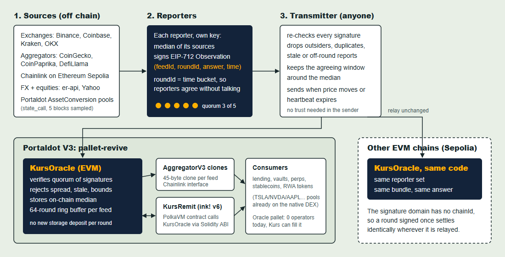

# Kurs

[](https://github.com/PugarHuda/kurs/actions/workflows/ci.yml)
[](https://kurs-ten-zeta.vercel.app/api/health)
[](https://github.com/PugarHuda/kurs/actions/workflows/health.yml)
[](https://www.npmjs.com/package/kurs-oracle)

**Price feeds for Portaldot V3, signed by independent reporters, readable from Solidity and ink!, and portable to any EVM chain.**

*Kurs* is Indonesian for "exchange rate", the number on the board at every money changer.

Portaldot Hacker House 2026 · Track: **Multi-Chain & Cross-Chain Infra**

**Live dashboard:** https://kurs-ten-zeta.vercel.app · **Evidence:** [`docs/evidence.md`](docs/evidence.md) · **Deck:** [`docs/kurs-deck.pdf`](docs/kurs-deck.pdf)

| Network | KursOracle | Status |
|---|---|---|
| Ethereum Sepolia | [`0xd3f6bf8e…a2cbc3`](https://sepolia.etherscan.io/address/0xd3f6bf8e595e815de11598f23170b37341a2cbc3) | live: 16 feeds (crypto, FX majors, gold, equities, tPOT) pushed by the relay, ERC-7412 pull used on chain, oracle + factory + converter verified on Sourcify (exact match) |
| **Portaldot V3 testnet** | `0x5bdd9713ddc4f11e14bd3094882401cd122656f4` ([round in the Node Console](https://node-console.portaldot.dev/?rpc=wss%3A%2F%2Ftest-node-v3.portaldot.dev#/explorer/query/299579)) | **live: 13 feeds, rounds from 5 reporters every ~64 min, mirrored unchanged to Sepolia; EUR/USD and gold added through the owner's 600-block timelock (block #336815); ink! v6 KursRemit `0x26d22f75…3530` reads it cross-VM** (GBP, JPY, CNY stay on Sepolia: a new feed costs ~15.6 tPOT of Revive deposit on Portaldot) |

### If a Portaldot feed looks stale: it is out of gas, and anyone can fix it

Every Portaldot round costs the relay ~0.1 tPOT (~12 tPOT a day for 13 feeds). Testnet tPOT comes only from the [POT Starter Hub faucet](https://pot-starter-hub.vercel.app/hub) (10 tPOT per wallet per day), so the gas payer can run dry. [`topup.yml`](.github/workflows/topup.yml) claims the faucet for the relay's own keys every 6 hours whenever the deployer holds less than 100 tPOT, and the relay resumes by itself as soon as gas arrives. To refill it directly, send tPOT to the deployer (it only pays gas, it holds no admin rights):

```
5CjEvXjS5WV7yUmqVQKoT9n1mTZpLQMcVaovDQXan1HAqYTx    (native, any Polkadot wallet)
0x1d63E7A1cC358Cb40Aa6073b7c44Fd3c916b2540          (EVM, same account)
```

Sepolia is unaffected (separate gas). `/api/health` and the dashboard show each feed's age, so a stale round is visible, never hidden.

### Fund the rest: what more tPOT deploys automatically on Portaldot

Already live on Portaldot: KursOracle, 13 Chainlink AggregatorV3 clones, KursConverter, KursDIA and the ink! v6 KursRemit. Everything below is live on Sepolia, and [`autodeploy.yml`](.github/workflows/autodeploy.yml) deploys it on Portaldot from the frozen source in this repo, in this order, within 6 hours of the deployer holding enough tPOT (cost + 100 tPOT kept for the relay). Each step reads its contracts back and commits the output to `docs/<step>-portaldot.txt`.

| Step | Contracts | What it adds | ~tPOT |
|---|---|---|---|
| 1 | KursFeedRegistry, KursQuoteOracle | Chainlink Feed Registry `latestRoundData(base, quote)`; ERC-7726 / Euler `getQuote` for any cross rate (EUR→IDR, gold→EUR, BTC→IDR) | 560 |
| 2 | KursBand, KursApi3, KursChronicle, KursAaveOracle | Band `getReferenceData`, API3 `read()`, Chronicle `read()`, Aave v3 `getAssetPrice`: protocols written for those oracles run unchanged | 870 |
| 3 | KursPyth, KursMorphoOracle | Pyth `updatePriceFeeds` + `getPriceUnsafe`; Morpho Blue `price()` for a BTC-collateral, Rupiah-loan market | 375 |
| | | **Total for everything** | **~1,805 + 100 reserve** |

Plan and shortfall at any time: `cd reporter && npx tsx scripts/autodeploy.ts --plan`. Not planned for Portaldot: one KursAggregatorV2V3 per feed (~258 tPOT each; the V3 clones cover the same consumers for 45 bytes each).



---

## Project overview

### Problem

Portaldot V3 runs EVM and ink! contracts side by side in `pallet-revive`, and people are already building money apps on it: tokenised TSLA, NVDA, AAPL, AMZN and META trade against DUCAT in the runtime's own DEX, there is a `pUSD` test dollar, and hacker-house teams are shipping lending, escrow and stablecoin contracts. **None of them can read a price.** We checked the live V3 testnet (spec `portaldot-v3` 3002):

| What we looked at | What is there |
|---|---|
| `Oracle` pallet (index 85) | Present, **0 values stored** |
| Oracle operator set (`TechnicalMembership.Members`) | **Empty**: no account can call `oracle.feedValues` |
| EVM precompiles | Assets, AssetsPermit, Vesting. **No oracle precompile** |
| Chainlink, Pyth, RedStone on Portaldot | Not deployed |
| Tokenised-stock pools on the native DEX | Price TSLA at about $0.04 when routed to pUSD (Kurs: about $410) |

A lending market listing those tokens today would have to price them from their own pools, which anyone can push around. That is how most DeFi exploits start.

### Solution

Kurs is a signed-observation oracle built for Portaldot's dual VM:

1. **Reporters** read many sources (exchanges, aggregators, Chainlink on Ethereum, FX and equity quotes, and Portaldot's own AssetConversion pools), take a median, and each **signs its own observation with EIP-712**.
2. **Anyone can transmit** a bundle of signatures. The transmitter is not trusted. The contract checks every signature.
3. **`KursOracle`** (Solidity on pallet-revive) requires a strict-majority quorum of distinct reporters, rejects stale or future timestamps and out-of-bounds values, **reverts when reporters disagree** by more than the feed's spread limit, and stores the **on-chain median**. A minority of dishonest reporters cannot move it.
4. **Solidity** consumers read it through the unchanged **Chainlink `AggregatorV3Interface`** (one 45-byte clone per feed). **ink!** consumers call the same contract through a Solidity-ABI cross-contract call: `KursRemit` (ink! v6, PolkaVM) reads `KursOracle` (EVM bytecode) inside the same pallet.
5. **Push and pull.** A relayer pushes rounds when the price moves or a heartbeat expires. A consumer that needs a fresher price than what is stored can **pull** one into its own transaction through **ERC-7412** (the pull-oracle interface used by RedStone and Synthetix): `latestRoundFresh` reverts `OracleDataRequired`, the client fetches a signed bundle (from the bundle API or its own reporters) and sends `fulfillOracleQuery` + its call together through Multicall3. [First pull on Sepolia, one transaction.](https://sepolia.etherscan.io/tx/0x9e2aa23575734bba9b24b2ea6d25e9fc414a9b18cf2c3f64e323c3e9b17c405f)
6. The signature domain carries **no chainId**, so **the same signed round settles to the same answer on any EVM chain** running Kurs. The tPOT price measured on Portaldot's own DEX can be exported to Ethereum, and ETH or BTC prices can be imported, with one set of signatures.

### Why it needs Portaldot

- Revive runs EVM and PolkaVM contracts in one pallet, so **one oracle serves both VMs**. On most chains you would deploy two.
- `pallet-asset-conversion` exposes pool prices through a runtime API (`AssetConversionApi_quote_price_exact_tokens_for_tokens`). Kurs reads it with `state_call` at several past blocks, which makes **a native Portaldot price** that other chains can consume.
- The runtime already reserves an `Oracle` pallet with an empty operator set. Kurs reporters are ready to be its operators: the value format (`u32` key, `u128` fixed point) maps directly.

### Blockchain relevance

Smart contracts (Solidity on pallet-revive, ink! v6 on PolkaVM), cross-VM calls, cross-chain data relay (EIP-712 portable signatures), DeFi infrastructure (Chainlink-compatible feeds), Substrate runtime APIs (`state_call` into AssetConversion), and Portaldot storage-deposit economics (ring buffer and clones, see below).

---

## Technical architecture

| Layer | Stack |
|---|---|
| Blockchain | Portaldot V3 testnet (`pallet-revive`, EVM chain id `420420777`), Ethereum Sepolia |
| Contracts | Solidity 0.8.28 (Foundry), ink! 6.0.0-beta.1 (PolkaVM, `cargo-contract` 6) |
| Reporter / transmitter | TypeScript, Node 22+, [viem](https://viem.sh) |
| Dashboard | Vite + TypeScript, no framework, no backend: reads public RPCs from the browser |

### Repository layout

```
contracts/          Foundry project
  src/KursOracle.sol          signed-median oracle (verify, aggregate, store)
  src/KursAggregatorV3.sol    Chainlink AggregatorV3 view + EIP-1167 clone factory
  test/KursOracle.t.sol       22 tests incl. fuzz, cross-chain replay, ring buffer
ink/kurs_consumer/  KursRemit, ink! v6 contract reading KursOracle via Solidity ABI
reporter/           sources, signing, bundle selection, transmit, deploy (CLI: kurs)
  src/feeds.ts                the 16 feeds and their sources (single source of truth)
  src/sources.ts              fetchers incl. Chainlink-on-Sepolia and AssetConversion
  src/kurs.ts                 EIP-712 signing, median, off-chain bundle checks
  src/chain.ts                deploy / configure / transmit
web/                dashboard ("Today's rates" board)
deployments/        addresses + tx hashes written by `kurs deploy`
docs/               architecture diagram, evidence of on-chain activity
```

### Smart contracts

**`KursOracle`**

| Function | What it does |
|---|---|
| `transmit(feedId, roundId, Observation[])` | Permissionless. Verifies ≥ quorum distinct reporter signatures, freshness (`maxObservationAge`, 5-minute future skew), low-s signatures, spread ≤ `maxSpreadBps`, bounds. Stores the median. |
| `latestRound(feedId)` | `(roundId, answer, observedAt, updatedAt)` |
| `getRound(feedId, roundId)` | Any of the last 64 rounds; empty if overwritten |
| `observationDigest(...)` | The EIP-712 digest a reporter signs |
| `oracleId()`, `fulfillOracleQuery(bytes)` | ERC-7412. `fulfillOracleQuery` takes `abi.encode(feedId, roundId, Observation[])`, runs every check `transmit` runs, and is idempotent (returns if that round or a newer one is stored), so batched consumer calls never trip over each other. |
| `latestRoundFresh(feedId, maxAge)` | Latest round, or ERC-7412 `OracleDataRequired(oracle, abi.encode(feedId, maxAge))` when the newest observation is older than `maxAge`. |
| `setReporters`, `setFeed`, `setMaxObservationAge` | Owner only. Quorum must be a strict majority. |
| `transferOwnership` / `acceptOwnership` | Two-step |

**`KursAggregatorFactory` / `KursAggregatorV3`**: `deploy(feedId)` creates a 45-byte EIP-1167 clone exposing `latestRoundData`, `getRoundData`, `decimals`, `description`, `version`.

**`KursConverter`**: a real pull consumer. `convert(amount)` multiplies by a USD/IDR price no older than `maxAge` (300 s on Sepolia), so it only works when the caller pulls a fresh bundle or the relay has just pushed one.

**`KursRemit` (ink! v6)**: `latest()`, `quote(amount)`, `quote_and_log(amount)` (emits `Quoted`), refuses prices older than `max_age`.

### Designed for pallet-revive's costs

Revive charges a storage deposit per byte of code and per storage item (`depositPerByte` 0.06 tPOT, `depositPerItem` 0.15 tPOT on V3). We measured `KursOracle`'s deployment at about 711 tPOT with `eth_estimateGas`, then designed around it:

- **Ring buffer**: each feed keeps 64 rounds in fixed slots. After warm-up a new round overwrites a slot, so it adds no new deposit.
- **Clones**: each feed's Chainlink adapter is a 45-byte EIP-1167 clone (about 3 tPOT) instead of a 2 KB contract (about 150 tPOT).
- **Push on change**: the transmitter sends a round only when the price moves by the feed's deviation threshold or its heartbeat expires.

### Feeds

| Feed | Sources | Notes |
|---|---|---|
| BTC/USD, ETH/USD | Binance, Coinbase, Kraken, OKX, CoinGecko, CoinPaprika, DefiLlama, **Chainlink (Sepolia)** | 50 bps deviation, 1 h heartbeat |
| DOT/USD, USDT/USD | exchanges + aggregators | |
| **EUR/USD, GBP/USD, USD/JPY, USD/CNY, USD/IDR** | Frankfurter (ECB reference rate), open.er-api, fawazahmed0 currency-api, Yahoo FX, CoinGecko (USDT in that currency) | global FX majors plus the Rupiah; quoted the market way, 25 bps deviation, 1 h heartbeat |
| **XAU/USD** (gold, troy ounce) | gold-api.com spot, PAX Gold (Kraken, CoinGecko), COMEX front month (Yahoo) | for gold-backed stablecoins and RWA collateral; 150 bps spread limit because futures carry a small contango |
| TSLA, NVDA, AAPL, AMZN, META /USD | Yahoo, Nasdaq quote API, TradingView scanner; a reporter needs at least 2 | the tokenised stocks that already trade on Portaldot |
| **tPOT/pUSD** | Portaldot `pallet-asset-conversion`, median of 5 quotes 50 blocks apart, thin pools refused | native Portaldot price, exportable |

A reporter abstains on a feed when fewer than `minSources` answer, and drops any source more than 5% from the others.

---

## Installation & setup

Requirements: Node 22+, [Foundry](https://getfoundry.sh), and for the ink! contract Rust with `cargo-contract` 6.0.0-beta (`cargo install cargo-contract --version 6.0.0-beta.2 --locked`, build with Rust 1.92 plus `rust-src`).

```bash
git clone https://github.com/PugarHuda/kurs && cd kurs

# contracts
cd contracts && forge test && cd ..

# reporter
cd reporter && npm ci && npm test
npx tsx src/cli.ts observe        # live prices from every source, no keys needed
cd ..

# dashboard
cd web && npm ci && npm run dev   # http://localhost:5173
```

### Run your own deployment

```bash
cp .env.example .env              # DEPLOYER_PK, REPORTER_1_PK .. REPORTER_5_PK
cd reporter
npx tsx src/cli.ts deploy portaldot        # oracle + factory + 11 feeds + clones
npx tsx src/cli.ts deploy sepolia          # same reporter set on Sepolia
KURS_CHAINS=portaldot,sepolia npx tsx src/cli.ts run   # relay every round to both
```

Run a reporter on its own machine and point a transmitter at it:

```bash
REPORTER_PK=0x... PORT=8787 npx tsx src/cli.ts serve
KURS_REPORTER_URLS=https://reporter-a.example,https://reporter-b.example npx tsx src/cli.ts run
```

### Pull a fresh price (ERC-7412)

```bash
# signed bundle from the hosted API (or omit KURS_BUNDLE_URL to sign with local reporter keys)
KURS_BUNDLE_URL=https://kurs-ten-zeta.vercel.app npx tsx src/cli.ts pull-convert 10000 sepolia
```

It simulates `KursConverter.convert`, catches `OracleDataRequired`, fetches the bundle, and sends `Multicall3.aggregate3([fulfillOracleQuery, convert])`. On a chain without Multicall3 (Portaldot V3 today) it sends the two calls in order: done on Portaldot, see the two `erc7412 pull` transactions in [`docs/evidence.md`](docs/evidence.md). The bundle API is `GET /api/bundle?pair=USD/IDR` on the dashboard host; `GET /api/feeds` lists feeds and addresses.

### Hosted parts

`bash scripts/set-secrets.sh` puts the testnet reporter keys on Vercel (for `/api/bundle`) and in GitHub Actions secrets (for `.github/workflows/relay.yml`, a push round every 10 minutes).

### ink! consumer

```bash
cd ink/kurs_consumer
cargo +1.92.0 contract build --release      # target/ink/kurs_consumer.polkavm
```

Instantiate with `new(oracle, keccak256("USD/IDR"), 3600)`, then call `quote(100_00)` to convert 100.00 USD to Rupiah.

### Local end-to-end

`reporter/test/e2e.test.ts` starts anvil, deploys, has five reporters sign different prices, transmits, and reads the median back through the AggregatorV3 clone.

---

## Deployment on Portaldot V3 testnet

| | |
|---|---|
| EVM RPC | `https://test-evm-rpc-v3.portaldot.dev` (chain id 420420777) |
| Substrate RPC | `wss://test-node-v3.portaldot.dev` |
| Explorer | https://scanner-testnet-v3.portaldot.dev |

Contract addresses, every transaction hash, and the reporter set are in [`deployments/`](deployments/) and summarised in [`docs/evidence.md`](docs/evidence.md) (regenerate with `cd reporter && npm run evidence`).

Deploying the oracle, factory, 11 feeds and KursConverter cost about 1,575 tPOT, almost all of it Revive storage deposit (0.06 tPOT per byte of code plus a 30% code-hash lockup, 0.15 tPOT per storage item); deposits are refundable when code or storage is removed. The ink! KursRemit was 10.7 KB of PolkaVM code (about 880 tPOT); encoding its one oracle call by hand (selector + `bytes32`, a fixed 4-word reply read through `pallet-revive-uapi`) instead of through ink!'s generic Solidity-ABI codec brought it to 7.2 KB (about 565 tPOT), same messages and event. It is live on Portaldot V3 at `0x26d22f75a6d33b5bdb4e598335826f3fa8553530` (583.4 tPOT, block 337224): `latest()` returned the oracle's USD/IDR round 29898288 exactly, and `quote_and_log` ran as a transaction.

**Relaying on Revive economically.** `reporter/scripts/deposit-probe.ts` measures a `transmit` on Portaldot: **7.91 tPOT** when the round opens a new ring-buffer slot, **0.107 tPOT** when it overwrites one. On chains marked `SLOT_ALIGNED` the transmitter therefore re-signs the fresh reading at `latest + 64k`, so every round lands on the feed's existing slot. The contract only requires round ids to increase and observations to be fresh, so this is as safe as minute rounds; it caps Portaldot at about one round per 64 minutes per feed, at ~0.1 tPOT each. The same signed bundle is then relayed unchanged to Sepolia, which ends up holding the identical round.

## Verify it yourself

The dashboard does not ask you to trust it. For the selected feed it fetches the latest round's transaction, decodes the signed observations from the calldata (a `transmit`, a `fulfillOracleQuery`, or either inside Multicall3), recovers every signer with EIP-712 in your browser, checks each one against the reporter set read from the contract, and recomputes the median. The pull panel does the same for a bundle before you use it.

## Testing

| Suite | Count | Command |
|---|---|---|
| Solidity (Foundry, 1,000 fuzz runs, invariants over 128k transmits), incl. ERC-7412 pull, 11 protocol adapters, the TWAP (fuzzed: the average stays within the prices it saw) and its keeper | 66 | `cd contracts && forge test` |
| Reporter unit + anvil e2e (vitest), incl. ERC-7412 pull on a chain without Multicall3 | 17 | `cd reporter && npm test` |
| Dashboard QA (Playwright, desktop + mobile, axe accessibility) against the production build and live Sepolia, plus every API response checked against `openapi.json` and every MCP tool called, plus `/api/quote`, CORS preflight, the TWAP panel, the converter, the board's feed groups, and **accuracy against independent references** (Chainlink's own Sepolia feeds for BTC/ETH within 2%, FloatRates for USD/IDR within 1%) | 56, plus one that sends a real Sepolia transaction from the dashboard's wallet button (local, needs a key) | `cd web && npm run test:e2e` (or `KURS_BASE_URL=https://kurs-ten-zeta.vercel.app`) |
| **Symbolic proofs (Halmos)**: the sort is ascending and a permutation, the median is bounded, and a lying minority (2 of 5) cannot move it outside the honest range, for every `int192` input with 3, 4 and 5 observations | 9 proofs, all PASS in CI ([docs/security.md](docs/security.md#symbolic-proofs-halmos)) | `cd contracts && halmos --match-contract KursHalmos` |
| **Cross-VM: ink! v6 reads the Solidity oracle** (local ink-node) | end to end | `cd reporter && npm run ink-e2e` |

The cross-VM run deploys KursOracle, transmits a 5-reporter USD/IDR round, deploys KursRemit (ink! v6, PolkaVM), and checks that `KursRemit.latest()` returns exactly the oracle's round, then sends `quote_and_log` as a real transaction. Output: [`docs/ink-e2e-local.txt`](docs/ink-e2e-local.txt). ink-node v0.47 does not accept EVM bytecode, so locally the oracle is compiled to PolkaVM with resolc 0.5.0; Portaldot V3 accepts EVM bytecode and runs the solc build. KursRemit only sees an H160 that speaks the Solidity ABI, so its code is the same in both cases.

What the tests cover: median of odd and even sets, a 2-of-5 lying minority cannot move the median, duplicate, outsider, tampered and high-s signatures, stale, future and replayed rounds, disagreement and bounds circuit breakers, strict-majority quorum, reporter rotation, two-step ownership, the AggregatorV3 adapter and clones, the ring buffer, **the same bundle verifying on a second chain id**, the viem digest matching the contract formula byte for byte, and off-chain bundle selection under vote spamming, malformed input and coordinated outliers.

## Ways to read Kurs

| Interface | For | Where |
|---|---|---|
| `KursOracle.latestRound(feedId)` / `latestRoundFresh(feedId, maxAge)` | any Solidity contract; ERC-7412 pull when stale | both networks |
| Chainlink **AggregatorV3** (`latestRoundData`), one 45-byte clone per feed | anything built for Chainlink | both networks |
| Chainlink **V2 + V3** (`latestAnswer`, `getAnswer`, ...) via `KursAggregatorV2V3` | Aave V3's `AaveOracle` and older Compound-style code | Sepolia (11 feeds, Sourcify-verified); Portaldot after the next tPOT top-up |
| **ERC-7726** `getQuote(amount, base, quote)` + **Euler `IPriceOracle`** (`name()`, `getQuotes` with bid = ask) via `KursQuoteOracle` | Euler v2's `EulerRouter` (drop-in adapter) and other modular lenders; BTC, ETH, USD, EUR, GBP, JPY, CNY, IDR and gold, with any cross rate through USD (100 EUR in JPY, 1 oz gold in EUR, 1 BTC in JPY) | Sepolia v3 `0xacef…3e3d` (Sourcify exact, reads in [`docs/global-sepolia.txt`](docs/global-sepolia.txt)); v2 `0xc176…0316` (BTC/ETH/IDR) stays live under KursSiloOracle; Portaldot estimate 229 tPOT, deferred so the relay keeps its gas |
| **Chainlink Feed Registry** (`latestRoundData(base, quote)`, `getFeed`, `decimals`, `getRoundData`, `latestAnswer`) via `KursFeedRegistry`, assets as Chainlink Denominations (ETH, BTC, ISO 4217 codes: USD 840, EUR 978, GBP 826, JPY 392, CNY 156, IDR 360, XAU 959) | protocols that look prices up by asset pair instead of storing one aggregator each; it returns the same AggregatorV3 clones | Sepolia `0x846f…0108` (Sourcify exact), 8 pairs, reads in [`docs/global-sepolia.txt`](docs/global-sepolia.txt) |
| **Silo v2 `ISiloOracle`** (`quote(baseAmount, baseToken)`, `quoteToken()`, `beforeQuote`) via `KursSiloOracle` | Silo v2 isolated markets: collateral priced in the market's quote token, stale prices revert with ERC-7412 | Sepolia `0xd43c…92c3` (Sourcify exact), quote token IDR |
| **TWAP** `consult(window)` / Uniswap-v3-style `observe(secondsAgos)` via `KursTwap`: a price accumulator over 48 observations, poked by the relay after every round, each round weighted from its on-chain `updatedAt` | lenders that want manipulation resistance on top of the signed median: one round barely moves a 1 h average. Shown next to the latest round on the dashboard | Sepolia (Sourcify exact): BTC/USD `0x2f43…4f15`, USD/IDR `0x4738…fadb` |
| **Chainlink Automation** (`checkUpkeep` / `performUpkeep`) and **Gelato** (`checker`) via `KursTwapKeeper` | any keeper network keeps the TWAPs current with no Kurs infrastructure; the Kurs relay itself calls `checkUpkeep` then `performUpkeep`, one transaction for every due TWAP | Sepolia `0xa1f3…3abc` (Sourcify exact) |
| **Pyth `IPyth`** (`getPrice`, `getPriceNoOlderThan`, `getPriceUnsafe`, `updatePriceFeeds`) via `KursPyth`; price id = Kurs feedId | apps already integrated with Pyth switch by changing one address. Pyth's pull flow maps 1:1: `updatePriceFeeds([bundle payloads from /api/bundle])` verifies them on chain, fee 0. `conf` is the feed's spread bound | Sepolia (Sourcify-verified; a real `updatePriceFeeds` tx is in evidence) |
| **Morpho Blue `IOracle.price()`** via `KursMorphoOracle`, one per market, priced through ERC-7726 | Morpho Blue markets: collateral value in the loan token scaled by 1e36, stale feeds revert with ERC-7412 | Sepolia: BTC collateral / 2-decimal Rupiah loan token (IDRX-style), `price()` = 1 BTC in Rp |
| **DIA `getValue("BTC/USD")`** via `KursDIA`; key = the Kurs pair, 8 decimals, `(0, 0)` for an unknown key exactly like DIA | DIA is the oracle most Polkadot-ecosystem dApps (Moonbeam, Astar) already read: one address change | **Portaldot V3** [`0x969b…dfd9`](docs/dia-portaldot.txt) (`getValue("tPOT/pUSD")` returns Portaldot's own native price) and Sepolia (Sourcify exact, reads in [`docs/compat-sepolia.txt`](docs/compat-sepolia.txt)) |
| **Band `IStdReference.getReferenceData(base, quote)`** + `getReferenceDataBulk` via `KursBand`; every symbol priced through USD, so any pair of the 16 feeds is a cross rate: `("EUR", "JPY")`, `("XAU", "EUR")`, `("BTC", "IDR")` | Band integrations (also on Astar and Moonbeam) | Sepolia (Sourcify exact) |
| **API3 `IApi3ReaderProxy.read()`** via `KursApi3ReaderProxy`, one per feed, 18 decimals | API3 dAPI consumers | Sepolia: BTC/USD, USD/IDR |
| **Chronicle `read()` / `readWithAge()` / `tryRead*`** via `KursChronicle`, one per feed | Sky (MakerDAO) style consumers | Sepolia: BTC/USD |
| **Aave v3 `IPriceOracleGetter.getAssetPrice(asset)`** via `KursAaveOracle`, USD base 1e8, Rupiah stablecoin priced as 1/(USD/IDR) | an Aave v3 fork's `PoolAddressesProvider`. This interface has no timestamp, so the adapter reverts on stale rounds (ERC-7412) | Sepolia |
| **Substrate runtime API** `ReviveApi_call` | Polkadot wallets, polkadot.js / PAPI clients, off-chain workers: no EVM RPC needed | Portaldot: [`/api/substrate`](https://kurs-ten-zeta.vercel.app/api/substrate), `reporter/src/substrate.ts` |
| ink! v6 cross-contract call (Solidity ABI) | ink! contracts on pallet-revive | `ink/kurs_consumer` |
| **MCP server** at [`/api/mcp`](https://kurs-ten-zeta.vercel.app/api/mcp) (Streamable HTTP, stateless): tools `list_feeds`, `get_price`, `convert` (direct, inverse or via USD, case-insensitive, every round returned with its age, `maxAgeSeconds` refuses stale prices), `get_history`, `get_signed_bundle`, `verify_bundle` (recovers every signer against the on-chain reporter set), `get_twap` | AI agents (Claude, Cursor, any MCP client): ask for a price and get the on-chain signed round, not a scraped number, and check a bundle without trusting whoever served it | Vercel; add it with `claude mcp add --transport http kurs https://kurs-ten-zeta.vercel.app/api/mcp`; [`/llms.txt`](https://kurs-ten-zeta.vercel.app/llms.txt) describes the API for LLMs |
| **npm package [`kurs-oracle`](https://www.npmjs.com/package/kurs-oracle)** (`npm i kurs-oracle viem`, source in [`sdk/`](sdk/)) on viem: `getPrice` (with `maxAge` → `StalePriceError`), `fetchBundle`, `verifyBundle` (EIP-712 signers vs. the on-chain reporter set and quorum), `getTwap`, `writeWithFreshPrice` (ERC-7412 in one call), ABIs and live addresses | TypeScript dapps and bots | `sdk/`, tested in CI against the live contracts |
| **x402** paywall at `/api/x402?pair=…`: the same signed bundle for 0.001 USDC on Base Sepolia, verified and settled by the x402.org facilitator ( `/api/bundle` stays free) | AI agents that pay per call with no account or API key; client: `reporter/scripts/pay-x402.ts` (EIP-3009) | Vercel. Tested: a forged authorization is refused (`invalid_exact_evm_signature`); a correctly signed one from an unfunded wallet passes the signature check and stops at `invalid_exact_evm_insufficient_balance`. A settled payment has not been made yet (no Base Sepolia USDC) |
| HTTP: `/api/feeds`, `/api/bundle`, `/api/health`, `/api/substrate`, `/api/history` (full round history from `RoundUpdated` logs, past the 64-round buffer), `/api/quote?amount=100&from=USD&to=IDR` (the MCP `convert` over HTTP: each round's age, `maxAge` → 409 instead of a stale answer), `/api/metrics` (Prometheus: feed age, answer, freshness, relayer gas balance, 1 h TWAP and the latest round's deviation from it, and `kurs_feed_config_drift` when the on-chain feed config no longer matches `feeds.ts`), `/api/x402`. Every endpoint answers CORS preflight (`X-PAYMENT` allowed), so browser agents can pay x402. Pairs are case-insensitive with `/`, `-` or `_` (`usd-idr`); `/api/history` takes `net`, `network` or `chain` | dashboards, ERC-7412 clients, monitors and Grafana, indexers | Vercel; OpenAPI 3.1 spec at [`/openapi.json`](https://kurs-ten-zeta.vercel.app/openapi.json), linted by Redocly and contract-tested against the live responses |

## Governance: a native Portaldot multisig owns the oracle

On Portaldot V3, `KursOracle.owner()` is not a key: it is a **2-of-3 `pallet-multisig` account**. `reporter/scripts/multisig-owner.ts` did the handoff on chain: signer A funded the multisig account, the deployer called `transferOwnership(<multisig's Revive address>)`, then `multisig.asMulti` wrapped `utility.batchAll[revive.mapAccount, revive.call(acceptOwnership)]`, approved by A and executed by B. From now on, adding a feed, rotating reporters or moving ownership takes two Substrate signatures that reach the EVM contract through `revive.call`. The dashboard's "Who can change Kurs here" panel reads `owner()` live; the extrinsics are in [`docs/evidence.md`](docs/evidence.md).

**Timelock.** The multisig then put a delay in front of itself, again with native pallets only (`reporter/scripts/timelock-owner.ts`): ownership moved to a **pure proxy** that the multisig controls through `pallet-proxy` with a **600-block delay (~1 hour)**. Every owner action is now announced by 2 of 3 signers (`proxy.announce`), can run only 600 blocks later (`proxy.proxyAnnounced`), and can be vetoed in between (`proxy.rejectAnnouncement`). Executing early was tried on chain and rejected (`proxy.Unannounced`); so was a single signer using the proxy directly (`proxy.NotProxy`). `owner()` now returns the pure proxy.

**The governance is used, not just installed.** `reporter/scripts/sync-feeds.ts` found that the equities' on-chain heartbeat (3600 s) no longer matched the relay's 4 h cadence on either chain, and fixed it through each owner: on Sepolia one Safe transaction (MultiSend of 5 `setFeed`, signed by 2 of 3 owners; the same batch is in [`docs/safe/sync-feeds-sepolia.json`](docs/safe/sync-feeds-sepolia.json) for the Safe{Wallet} Transaction Builder), on Portaldot a 2-of-3 `proxy.announce` of `utility.batchAll[revive.call(setFeed) x5]`, executed by `proxy.proxyAnnounced` only after the 600-block delay. Transactions in [`docs/evidence.md`](docs/evidence.md#governance-in-use-feed-config-sync).

On Ethereum Sepolia the same role belongs to a **2-of-3 Safe** (`reporter/scripts/safe-owner.ts`, Safe{Core} protocol-kit): the Safe was deployed, the deployer proposed it, and two Safe owners signed `acceptOwnership`. No Kurs deployment is owned by a single key any more.

## Operations

- **Relay**: `.github/workflows/relay.yml` runs hourly and keeps `kurs run` alive for 57 minutes (a round check every 2 minutes), pushing to Portaldot (slot-aligned) and mirroring the identical bundle to Sepolia. A plain `*/10` cron fired once in two hours on this repo, so the loop design is deliberate. A feed is pushed when it moves past its deviation threshold or reaches its heartbeat: crypto and USD/IDR hourly, the five equities every 4 h unless they move 0.25% (US markets are closed most of the week, and every Portaldot round costs tPOT).
- **Health**: `GET /api/health` returns the age of every feed on both networks and answers 503 when one is older than twice its heartbeat (Portaldot: the 64-minute cadence). `.github/workflows/health.yml` checks it hourly: on failure it restarts the relay and opens a `health` issue, and the next healthy check closes it.
- **Relay chaining**: each relay run dispatches the next one when it ends, so the feeds no longer depend on GitHub cron, which stopped firing for hours on this repo.

## Security model and limits

- **Trust**: the reporter set and its strict-majority quorum. A minority cannot move the median and cannot forge a round. The owner (who can rotate reporters and change feed parameters) is a 2-of-3 multisig on both networks: native pallet-multisig on Portaldot, a Safe on Sepolia.
- **Transmitter**: untrusted. It can only choose *when* to submit, and it re-checks everything off chain so one bad reporter cannot make a bundle revert.
- **Today's reporters** are five keys run by the Kurs team. The protocol is built for independent operators (`kurs serve` plus `KURS_REPORTER_URLS`), and reporter rotation is one owner transaction.
- **Equities** come from three free public quotes (Yahoo, Nasdaq, TradingView) with a two-source minimum; they are 15-minute delayed outside real-time hours. A licensed real-time feed is the mainnet upgrade.
- **tPOT/pUSD** comes from one AMM. It is sampled across about 20 minutes of blocks and rejects pools under 100 pUSD; the testnet pool holds about 127 pUSD.
- Not audited.

## Roadmap

- Done during the hacker house: oracle, clones, ring buffer, push relay and ERC-7412 pull, bundle API, 16 feeds (13 on Portaldot), ink! v6 consumer verified cross-VM, dashboard with in-browser signature verification, a converter computed from the on-chain rounds, and a wallet button that sends a verified bundle plus a $100 conversion in one Sepolia transaction (ERC-7412 from the visitor's own wallet), live on Portaldot V3 and Sepolia with an hourly relay and /api/health, ERC-7412 pull executed on both chains, owner handed to a native 2-of-3 pallet-multisig (Portaldot) and a 2-of-3 Safe (Sepolia), 139 automated tests incl. Foundry invariants over 128k random transmits, Slither in CI with every finding triaged in [docs/security.md](docs/security.md), Lighthouse on mobile (2026-11-04, after adding the converter and wallet pull): performance 94-97, accessibility, best practices and SEO 100.
- Next: independent reporter operators from the Portaldot community; Kurs reporters as operators of the runtime `Oracle` pallet, so native pallets and contracts read the same prices; a read precompile proposal for the `Oracle` pallet; more chains in the relay (Base, BSC, Arbitrum), plus the bridge at bridge.portaldot.dev for POT-denominated feeds.

## Prior work and third-party code

- [forge-std](https://github.com/foundry-rs/forge-std) (MIT, vendored in `contracts/lib`), [viem](https://github.com/wevm/viem) (MIT), [ink!](https://github.com/use-ink/ink) (Apache-2.0), [Vite](https://vitejs.dev) (MIT), [DSEG font](https://github.com/keshikan/DSEG) (OFL-1.1), Archivo (OFL-1.1).
- EIP-1167 minimal-proxy bytecode, Chainlink's `AggregatorV3Interface` shape.
- Same author as [pdk](https://github.com/PugarHuda/portaldot-dev-kit) (1st place, Portaldot Mini Hackathon S1, Builder Tools). No pdk code is reused in Kurs.

## Team

- **Pugar Huda Mantoro**: contracts, reporter, dashboard. GitHub [@PugarHuda](https://github.com/PugarHuda) · Discord: Bang Drop

## License

MIT, see [LICENSE](LICENSE).
